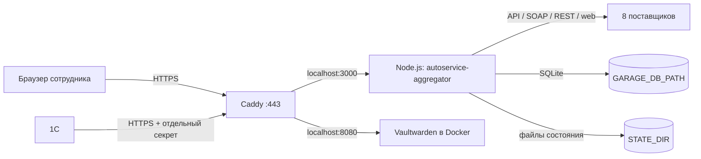

# CD Agregator: устройство приложения и сервера

Дата сводки: 9 ноября 2026 г.
Проект в рабочей папке: `autoservice-aggregator`, версия из `package.json` — `0.1.0`.
Документ описывает локальный исходный код и сведения, полученные при предыдущей проверке сервера. Значения паролей, ключей и токенов сюда намеренно не записаны.

## Кратко

CD Agregator — серверное приложение для поиска и закупки автозапчастей у нескольких поставщиков. Серверная часть написана на Node.js 26 и TypeScript, интерфейс — на обычных браузерных JavaScript-модулях. Результаты поиска передаются браузеру потоком SSE.

На сервере приложение запущено как systemd-служба `autoservice-aggregator.service`, слушает `127.0.0.1:3000`, а Caddy принимает внешние HTTPS-запросы на `aggregator.kovlab.com` и перенаправляет их на локальный порт приложения. На том же сервере отдельно работает Vaultwarden на `127.0.0.1:8080`.

Главный выявленный риск: служба агрегатора запускается от `root` из `/root/Aggregator`, а в наблюдавшейся конфигурации systemd не были включены основные ограничения процесса. Если уязвимость приложения даст выполнение команд, последствия могут затронуть весь сервер.

## Схема



Схема показывает проектную архитектуру. Фактические расположения SQLite-файла и `STATE_DIR` на сервере не установлены: содержимое серверного environment-файла не читалось.

## Сервер: что было подтверждено

Параметры ниже получены при предыдущем осмотре сервера 9 ноября 2026 г. Это не повторная проверка текущего состояния: при подготовке этого документа локальный SSH-туннель на порт `22422` отказал в соединении.

| Компонент | Наблюдавшееся значение |
|---|---|
| Имя сервера | `v3232213.hosted-by-vdsina.ru` |
| Публичный IPv4 | `91.184.246.232` |
| ОС / архитектура | Ubuntu 26.04 LTS, x86_64 |
| Ядро | `7.0.0-14-generic` |
| Node.js на сервере | `v26.8.1` |
| Агрегатор | `autoservice-aggregator.service`, при проверке был active |
| Caddy / Docker | при проверке были active |
| Внешние TCP-порты | `22`, `80`, `443` |
| Внешний UDP-порт | `443` (Caddy HTTP/3) |

### Маршрутизация Caddy

Проверенное содержимое `/etc/caddy/Caddyfile`:

```caddyfile
password.kovlab.com {
    reverse_proxy localhost:8080
}

aggregator.kovlab.com {
    reverse_proxy localhost:3000
}
```

Наблюдавшиеся локальные слушатели: Node.js на `127.0.0.1:3000`, Vaultwarden на `127.0.0.1:8080`, API управления Caddy на `127.0.0.1:2019`. Порт `8080` был опубликован Docker только на loopback и перенаправлялся в контейнер на порт `80`.

### Systemd-служба агрегатора

Проверенные свойства `autoservice-aggregator.service`:

- unit-файл: `/etc/systemd/system/autoservice-aggregator.service`;
- пользователь: `root`;
- рабочая папка: `/root/Aggregator`;
- команда запуска: `/usr/bin/node` с точкой входа `src/backend/server.ts`;
- перезапуск при ошибке: `Restart=on-failure`, пауза 5 секунд;
- environment-файл: `/etc/autoservice-aggregator/credentials.env`.

Файл `credentials.env` и его значения не читались. Поэтому неизвестно, какие конкретно адреса `STATE_DIR` и `GARAGE_DB_PATH` заданы в production. Также не сверена версия исходного кода на сервере с текущей рабочей папкой: ограниченная учётная запись не могла читать `/root/Aggregator`.

При осмотре не были включены следующие systemd-ограничения: `NoNewPrivileges`, `ProtectSystem`, `ProtectHome`, `PrivateTmp`, `DynamicUser`, `RestrictSUIDSGID` и `LockPersonality`.

### Vaultwarden

При проверке `docker ps` показывал контейнер из образа `vaultwarden/server:latest`, состояние — healthy, публикация `127.0.0.1:8080 -> 80/tcp`. Команда `docker compose` на сервере была недоступна. Чем именно контейнер создаётся и обновляется, где хранятся его данные и как настроено резервное копирование — не выяснено. Тег `latest` не фиксирует версию образа, поэтому повторяемость обновления не гарантирована.

## Как устроено приложение

### Основные части исходного кода

| Путь | Назначение |
|---|---|
| `src/backend/server.ts` | Точка входа, создание служб и запуск HTTP-сервера. Слушает `127.0.0.1`, порт `3000` по умолчанию. |
| `src/backend/http/` | Маршруты, разбор и проверка запросов, JSON/SSE-ответы, раздача фронтенда, заголовки безопасности. |
| `src/backend/application/` | Сценарии приложения: поиск, управление сессиями поставщиков, корзина и оформление заказов. |
| `src/backend/search-service.ts` | Сборка зависимостей приложения, адаптеров поставщиков, хранилищ и фоновых сервисов. |
| `src/backend/suppliers/` | Интеграции с поставщиками, авторизация, преобразование ответов. |
| `src/backend/auth/` | Пользователи, пароли, сессии и проверка разрешений. |
| `src/backend/session/` | Состояние авторизаций поставщиков и зашифрованные учетные данные. |
| `src/backend/garage/`, `purchasing/`, `repairs/`, `notifications/`, `applicability/` | Гараж, корзина и заказы, обмен с 1С, уведомления и применимость. |
| `src/frontend/` | Интерфейс на нативных JS-модулях без отдельного сборщика фронтенда. |

Проект использует ESM, `pnpm-lock.yaml`, TypeScript и встроенный Node.js `node:sqlite`. В `package.json` основной runtime-зависимостью указан Playwright. Минимальная версия Node.js по проекту — 26.

### Поиск и поток результатов

1. Браузер отправляет запрос на `GET /api/search`.
2. Сервер проверяет сессию пользователя и разрешение.
3. Сервис поиска выбирает подключенные адаптеры и запускает поиск параллельно.
4. Каждый адаптер обращается к API, SOAP-сервису или веб-интерфейсу своего поставщика.
5. Ответы проверяются и приводятся к общей модели предложений.
6. Промежуточные статусы и результаты передаются браузеру по SSE; в коде предусмотрены события начала, статуса поставщика, результата и завершения поиска.

Клиент получает нормализованные данные, а не необработанный ответ поставщика. Для внешних запросов предусмотрены тайм-ауты, отмена по сигналу, проверка формата ответа и преобразование ошибок интеграций в безопасные HTTP-ошибки.

### Поставщики

| Поставщик | Способ интеграции по исходному коду / README |
|---|---|
| Rossko | Официальный SOAP API; ключи K1/K2 вводятся в настройках. Поддерживаются поиск и заказ. |
| Armtek | WebService API; учетные данные могут задаваться в окружении или через интерфейс. Поддерживаются поиск и заказ. |
| PartKOM | Официальный Web Services v4 API, Basic-аутентификация. Поддерживаются поиск и заказ. |
| STParts | ABCP API; пакетный поиск артикула и бренда. |
| Forum-Auto | REST API; поддерживаются поиск и заказ. |
| Autopiter | SOAP API v2; поиск, корзина, оформление через MakeOrderByItems, история счетов и уведомления об изменениях заказов на сайте и в ВК. |
| MotorDetal | API с токенами доступа и обновления. |
| Mladov | Веб-интеграция с браузерным состоянием, хранимым на сервере. |

Это описание интеграций в коде. Оно не подтверждает, что все восемь поставщиков сейчас авторизованы и доступны в production.

### Функции приложения

- Поиск цен, аналогов и кроссов по нескольким поставщикам с параллельной выдачей результатов.
- Нормализация предложений, статусов наличия и данных поставщика.
- Поиск применимости через PartsAPI, кеширование результатов и маршрутизация через прокси при определённом ответе об ограничении IP.
- Корзина, вкладки/пакетные позиции, обновление предложений и тестовый заказ; реальные заказы для поддерживаемых поставщиков.
- История заказов и работа с отменами для поддерживаемых интеграций.
- Гараж автомобилей и связанные позиции/группы.
- Обмен карточками заказ-нарядов с 1С, отдельные рабочие и тестовые данные.
- Уведомления о заказах и интеграция уведомлений во ВКонтакте. По документации приложения фоновая проверка выполняется примерно раз в 10 минут, приостанавливается ночью и координируется с нагрузкой от поставщиков.
- Администрирование пользователей и разрешений.
- Варианты артикула для некоторых позиций ВАЗ.

## HTTP API и доступы

Основные группы маршрутов, видимые в исходном коде:

| Группа | Примеры | Кто может использовать |
|---|---|---|
| Поиск | `/api/search` | Пользователь с разрешением на проценку |
| Состояние приложения | `/api/health` | Доступность приложения; маршрут не равен полной диагностике сервера |
| Сессии поставщиков | `/api/suppliers/sessions`, `/api/suppliers/{supplier}/authorize`, `logout` | Чтение статуса — обычный авторизованный поток; управление поставщиками — администратор |
| Применимость | `/api/applicability/*` | Пользователь с правом на применимость |
| Корзина | `/api/cart/*` | Пользователь с правом на проценку |
| Гараж | `/api/garage/*` | Пользователь с правом на проценку |
| Заказ-наряды | `/api/repairs` | Разрешение рабочей или тестовой формы; сотрудник видит закрепленные карточки, администратор — все |
| Интеграция 1С | `/api/integration/1c/repairs*` | Отдельный серверный секрет; обычная сессия пользователя не используется |
| Пользователи / VK | `/api/users`, `/api/notifications/vk*` | Администратор |
| Уведомления по заказам | `/api/notifications/orders*` | Авторизованный пользователь в рамках UI |

Пользователи хранятся в SQLite. Пароли сотрудников записываются как salted `scrypt`-хеши. Сессионный токен передается в HttpOnly-cookie; в базе хранятся данные сессий. Срок сессии, указанный в README, — 30 дней. Разрешения разделяют проценку, применимость, рабочие и тестовые заказ-наряды.

**Особенность интеграции с 1С:** эти маршруты проходят отдельную проверку серверного секрета и не требуют пользовательской cookie. Этот секрет следует считать полноценным ключом доступа к импорту/статусу заказ-нарядов.

## Данные и секреты

### SQLite и файловое состояние

Приложение использует один SQLite-файл `GARAGE_DB_PATH` (Node.js `DatabaseSync`). По коду и документации в нём находятся, среди прочего:

- пользователи, salted-хеши паролей и сессии;
- рабочие и тестовые карточки заказ-нарядов;
- корзина, вкладки, попытки/результаты заказов и отмены;
- данные гаража и интерфейсные настройки;
- уведомления и очередь исходящих сообщений;
- кеш применимости.

`STATE_DIR` предназначен для файлов состояния и интеграций: учетных данных, cookies/browser storage, токенов, настроек PartsAPI и параметров VK. В исходниках и документации перечислены файлы вроде `supplier-credentials.enc.json`, `partsapi-key.enc.json`, `partsapi-proxies.enc.json` и `vk-order-notifications.enc.json`. Некоторые поставщики хранят собственные файлы сессии отдельно.

Когда `SUPPLIER_CREDENTIALS_ENCRYPTION_KEY` настроен, соответствующие учетные данные и настройки шифруются AES-256-GCM перед сохранением. Сам мастер-ключ хранится отдельно и не должен находиться рядом с этими файлами. Без ключа проверенные runtime-учетные данные остаются в памяти процесса; функции, которым нужно сохранять ключ PartsAPI или настройки/ключ VK, не смогут надежно сохранить их на диск.

Для файлов, содержащих SQLite WAL/SHM, резервную копию нужно делать согласованно и сохранять каталог базы целиком. Потеря мастер-ключа шифрования может сделать сохраненные учетные данные нечитаемыми.

### Переменные и учетные данные

Названия ниже видны в `.env.example`, исходном коде или документации. **Их фактические значения не читались и в этот файл не включены.** Примеры путей в `.env.example` — шаблон, а не доказательство реального расположения на сервере.

| Имя / источник | Для чего используется | Значение проверено? |
|---|---|---|
| `AGGREGATOR_ADMIN_PASSWORD` | Первичное создание администратора в production; далее пароль меняют в интерфейсе управления пользователями. | Нет |
| `ONEC_REPAIRS_INTEGRATION_SECRET` | Отдельная аутентификация обмена с 1С. | Нет |
| `SUPPLIER_CREDENTIALS_ENCRYPTION_KEY` | Base64-ключ на 32 байта для AES-256-GCM шифрования выбранных учетных данных/настроек в `STATE_DIR`. Ключ должен храниться отдельно от зашифрованных файлов. | Нет |
| `ARMTEK_LOGIN`, `ARMTEK_PASSWORD` | Учетная запись Armtek, если она задается через окружение. | Нет |
| `STPARTS_API_LOGIN`, `STPARTS_API_PASSWORD` | Учетная запись STParts API. | Нет |
| `ARMTEK_VKORG`, `ARMTEK_KUNNR_RG`, `ARMTEK_KUNNR_ZA`, прочие `ARMTEK_*` | Идентификаторы аккаунта и параметры заказов Armtek; часть не является секретом, но влияет на работу интеграции. | Нет |
| Настройки поставщиков в интерфейсе | Rossko K1/K2, PartKOM, Autopiter, Forum-Auto, MotorDetal и Mladov учетные данные. | Нет |
| Состояние в `STATE_DIR` | Cookies, browser state и API-токены отдельных поставщиков. | Файлы на сервере не проверены |
| PartsAPI key и прокси | Ключ PartsAPI и учетные данные прокси для применимости. | Нет |
| Настройки VK | Ключ сообщества/подключение и параметры уведомлений. | Нет |
| `ROSSKO_ORDER_*` | Имя покупателя, контактное лицо, телефон и параметры доставки по умолчанию; контактные данные требуют защиты, даже если это не API-пароли. | Нет |
| `/etc/autoservice-aggregator/credentials.env` | Файл окружения systemd; путь подтвержден в unit, содержимое не читалось. | Только путь подтвержден |

В `.env.example` для `STATE_DIR` и `GARAGE_DB_PATH` приведены примеры `/var/lib/autoservice-aggregator` и `/var/lib/autoservice-garage/garage.sqlite`. Нельзя считать, что сервер использует именно эти пути, пока значения окружения не проверены.

## Риски и что стоит исправить

### 1. Служба работает от root — приоритет высокий

Наблюдавшаяся служба запускает сетевое приложение как `root` и держит код внутри `/root/Aggregator`. Это резко увеличивает последствия ошибки в HTTP-обработчике, библиотеке или интеграции с поставщиком. Практический план исправления: создать отдельного системного пользователя; перенести код из `/root` в каталог приложения, например `/opt/autoservice-aggregator`; выдать этому пользователю доступ только на чтение к коду и запись только в выделенные каталоги данных; после этого включить подходящие ограничения systemd и проверить работу сервиса.

### 2. Caddy не добавляет отдельную proxy-аутентификацию

В проверенном Caddyfile есть только `reverse_proxy`. Доступ пользователей контролирует само приложение. Для интеграции с 1С используется отдельный секрет. Следует отдельно проверить правила firewall, сетевые ACL и ротацию секрета; одно только наличие HTTPS не заменяет авторизацию.

### 3. Реальная конфигурация секретов не проверена

Путь к `credentials.env` известен, но содержимое намеренно не читалось. Не подтверждены фактические права этого файла, переменные `STATE_DIR`/`GARAGE_DB_PATH`, наличие мастер-ключа, список сохранённых аккаунтов и шифрование файлов в production. Значения секретов не следует присылать в чат: для аудита достаточно вывода имен переменных, владельцев/прав и наличия значений без самих значений.

### 4. Vaultwarden использует плавающий тег `latest`

Тег `latest` может указывать на разные версии в разные моменты. Лучше закрепить конкретную версию образа и документировать способ запуска, тома, резервное копирование и процесс обновления.

### 5. Версия исходников на сервере не сверена

Не удалось прочитать `/root/Aggregator` учетной записью осмотра. Поэтому все выводы об устройстве приложения относятся к текущей локальной рабочей папке; реальный production-код может отличаться.

## Доступ и уборка после проверки

Порядок подключения через MobaXterm и локальный SSH-туннель описан отдельно: [`docs/agent-server-access.md`](agent-server-access.md). В ходе подготовки архитектурного документа порт туннеля `127.0.0.1:22422` отказал в соединении, поэтому новые проверки сервера не выполнялись.

Ранее для чтения был создан пользователь `codex-audit-20261109`; отпечаток добавленного ключа был сверён. Текущее наличие этой учетной записи на сервере не перепроверено. После завершения аудита владелец может удалить временную учетную запись и ключ из `authorized_keys` на сервере. Не удаляйте основной пользовательский ключ или рабочие ключи развертывания.

## Источники и пределы уверенности

- **Локальный код:** `package.json`, `.env.example`, `README.md`, `src/backend/` в рабочей папке проекта на ветке `codex/aggregator-architecture-20261109`.
- **Сервер:** ранее показанные результаты проверки systemd, Caddy, Docker, слушающих портов, ОС и Node.js от 9 ноября 2026 г.
- **Не проверено:** текущая доступность сервера и служб, фактические значения environment, права на `credentials.env`, каталоги БД/состояния, содержимое `/root/Aggregator`, версия развернутого кода, способ запуска и данные контейнера Vaultwarden.
- **Не проводилось:** чтение паролей/токенов, изменение конфигурации сервера, проверка уязвимостей или тестирование production-запросами.
